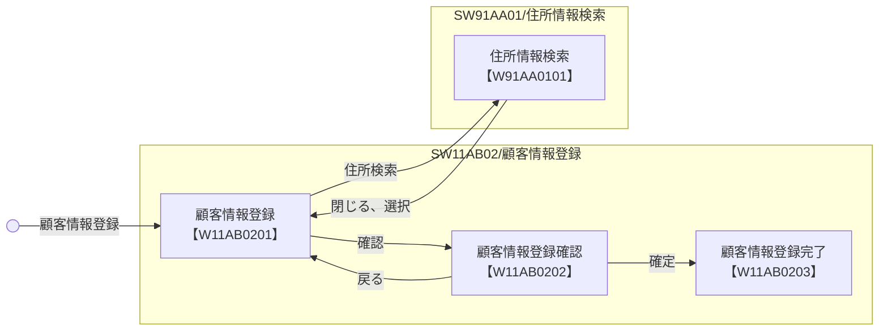

# ipa-ai-driven

Word や Excel で書かれた設計書を、AI が読める文書に作り直すための道具です。作り直した文書は、開発を手伝う AI「GitHub Copilot」に読ませて使う計画です。

**開発の途中です。まだ業務には使えません。** 公開されているサンプルの設計書で、動作を確かめている段階です。

このページの読み方:

- どんな道具かを知りたい人は、[今の状態](#今の状態) まで読めば足ります。今は、読むほかにしていただくことはありません。
- 自分で動かしたい開発者は、[動かしてみる](#動かしてみる開発者向け) を読んでください。
- この道具の開発に加わる人は、[開発に加わる人へ](#開発に加わる人へ) を読んでください。

名前に「ipa」とありますが、IPA（情報処理推進機構）が作った道具ではありません。IPA が公開している手引きに沿って開発しています。

## 何のためのものか

この道具は、ある会社のファームウェア開発部門（機器に組み込むソフトウェアを作る部門）の依頼で作っています。依頼者によると、この部門の設計書のほとんどは Word と Excel で書かれています。開発を AI に手伝わせるために、設計書を AI に読ませたいのですが、次の問題があります。

- 依頼者によると、AI は Word や Excel のファイルをそのままではうまく読めない。
- 既存の変換ツールでは、四角や矢印で描いた図が消えてしまう。試した変換ツール（MarkItDown）とサンプルの設計書で、消えることを確かめた。

この道具は、設計書を、文字だけでできたファイルに作り直します。図は、文字で書いた図に置き換えて残します。

使うのは、設計書を作り直す作業の担当者です。誰が担当するかは、まだ決まっていません。作り直した文書を AI 経由で使うのは、部門の開発者と想定しています（依頼者には未確認）。

## 何をするのか（例）

サンプルの設計書にある図の1つで、作り直す前と後を示します。

**作り直す前。** Excel に四角と矢印で描かれた図です。この道具が作った画像から、図の部分を切り出しています。画面がどの順に切り替わるかを表しています。薄い「SAMPLE」の文字は、もとの設計書に入っているものです。


**作り直した後。** 同じ図を、文字で書いたものです。

```
flowchart LR
    s26761((" "))
    subgraph s26744["SW11AB02/顧客情報登録"]
        s26684["顧客情報登録<br>【W11AB0201】"]
        s26690["顧客情報登録確認<br>【W11AB0202】"]
        s26693["顧客情報登録完了<br>【W11AB0203】"]
    end
    subgraph s26743["SW91AA01/住所情報検索"]
        s26715["住所情報検索<br>【W91AA0101】"]
    end
    s26761 -->|"顧客情報登録"| s26684
    s26684 -->|"確認"| s26690
    s26690 -->|"戻る"| s26684
    s26690 -->|"確定"| s26693
    s26684 -->|"住所検索"| s26715
    s26715 -->|"閉じる、選択"| s26684
```

読み方は次のとおりです。

- `s26684` のような「s と数字」は、図の部品1つずつの番号です。Excel がファイルの中で付けている番号で、画面には出ません。
- `s26684["顧客情報登録…"]` の行は、四角とその中の文字を表します。`<br>` は改行です。
- `s26761((" "))` は、左端の黒丸です。
- `subgraph` から `end` までは、水色の枠と、その中にある四角を表します。
- `s26684 -->|"確認"| s26690` の行は、矢印を表します。「顧客情報登録の画面から、『確認』で、顧客情報登録確認の画面へ移る」という意味です。

この書き方は Mermaid（マーメイド）と呼ばれるものです。GitHub（このページを置いているサービス）の画面では、上の文字が次のように図として表示されます。



この例について、知っておいてほしいこと:

- 画像の右下にある「一覧照会へ」は、文字の図に入っていません。つながる矢印が見つからず、移る先を判断できなかったためです。作り直した文書には、確かめが必要な箇所として印を付けて残しています。
- この例は、GitHub Copilot に書かせたものではありません。はじめは開発中の環境で GitHub Copilot を使えなかったため、別の AI に代わりに書かせました。そのあと、通常と違うつなぎ方で GitHub Copilot を動かして書かせたところ、もとの図にない矢印が2本書かれ、直すよう頼んでも直りませんでした。GitHub Copilot では、この例のような結果はまだ得られていません。
- 画像では「住所情報検索」の四角だけ点線です（別の小さな窓で開く画面を表す）。文字の図では区別を書けないため、作り直した文書では図のすぐ下に補足として書いています。
- 文書の全体は [migrated/screen-transition/document.md](migrated/screen-transition/document.md) にあります。人の確認はまだで、確かめが必要な箇所が3件残っています。

## 作り直す流れ

次の流れで進める計画です。AI は書き間違えることがあるため、AI に書かせるのは図だけにして、結果を、プログラム、別に動かした AI、人が確かめます。

1. **プログラム**が、設計書から文章と表を取り出し、下書きを作る。図は画像として保存する。
2. **GitHub Copilot** が、図の画像を見て、文字で書いた図に書き直す。
3. **プログラム**が、もとの設計書の文字が、作り直した文書にすべて残っているかを調べる。
4. **GitHub Copilot** を、書き直しとは別の指示でもう一度動かし、もとの図と見比べさせる。
5. **人**が最後に確かめて、承認する。

## 今の状態

確かめた環境は、Linux、Python 3.13、LibreOffice（無料の表計算ソフト）です。Windows と Excel では、まだ確かめていません。GitHub Copilot は、通常と違うつなぎ方で動かし、1つの図についてだけ試しました。GitHub Copilot では、使う AI の種類（モデル）を選べます。結果を得られたのは gpt-4.1 だけです。ほかの4つは、このつなぎ方では応答しませんでした。

| 項目 | 状態 |
|---|---|
| 流れ 1: 文章と表を取り出す | できる |
| 流れ 1: 図を画像として保存する | LibreOffice ではできる。ただし、画像がもとの図と違うことがある。例とは別の図で、矢印1本が、ファイルの中の記録と違う向きに描かれた。記号の説明（凡例）の文字の一部が描かれなかった図もある。Excel では試していない |
| 流れ 2: GitHub Copilot が図を書き直す | 試したときは、誤りが出た。直すよう頼んでも直らなかった |
| 流れ 3: 文字の抜けを調べる | できる。1〜2文字の短い言葉の抜けは、見つけられないことがある |
| 流れ 4: GitHub Copilot が見比べる | 試したときは、もとの図にない矢印を見逃した |
| 流れ 5: 人が承認する | まだ行っていない |
| 作り直した文書を GitHub Copilot に読ませて、質問に答えさせる | 試した4回とも、文書を読まずに答えた。うち3回は、文書にない内容を答えた |
| Word の設計書を作り直す | まだできない |
| 設計書に貼り付けられた画像（画面の写しなど）の中の文字を読む | まだできない |
| 実際の業務の設計書で使う | まだ試していない |

道具の概要は、ここまでです。この先は、開発者向けの内容です。

## 動かしてみる（開発者向け）

コマンドを使える開発者向けです。流れの 1 と 3 を、サンプルの設計書で試せます。サンプルの出どころは [samples/nablarch/README.md](samples/nablarch/README.md) にあります。

必要なもの:

- Git と、Python 3.10 以上
- LibreOffice か、Excel（Windows）。図を画像として保存するために使います。確かめてあるのは LibreOffice だけです

```
git clone https://github.com/xclang-brain/ipa-ai-driven.git
cd ipa-ai-driven
pip install -e ".[excel,dev]"
python -m docmig migrate "samples/nablarch/画面遷移図_サンプル.xlsx" --out migrated/trial-01
```

`docmig` は、この道具のプログラムの名前です。最後の行が、流れの 1 です。成功すると次のように表示され、`migrated/trial-01/` に下書き（`document.md`）と図の画像ができます。1行目は、図の保存に使ったソフトの名前です。

```
描画: libreoffice
下書きを作成: migrated/trial-01/document.md（シート 5、図 5）
```

続けて、流れの 3 を実行します。

```
python -m docmig verify migrated/trial-01
```

次のように「不合格」と表示され、そのあとに「文字の欠落」と「図が未記入」の行がたくさん続きます。図をまだ書き直していないためで、正しい動きです。図の中の文字は、図を書き直すまで「欠落」と数えられます。「原本」は、もとの設計書のことです。「要確認の印」は、確かめが必要な箇所に付ける印です。

```
判定: 不合格
確認の状態: 未確認
原本の文字列: 111 件中、欠落 77 件
図: 5 件中、未記入 5 件
要確認の印: 0 件
```

試し終わったら、`migrated/trial-01` のフォルダを消してください。残っていると、次に同じコマンドを実行したときに「既にある」と表示されて止まります。

流れの 2、4、5 の手順は、[docs/runbook.md](docs/runbook.md) の手順 3、5、6 にあります。この手順書は Windows と Excel を前提に書かれています。GitHub Copilot の契約と、Copilot CLI（コマンドで GitHub Copilot を使う道具）が必要です。

## フォルダの中身

| 場所 | 中身 |
|---|---|
| `samples/` | 試すための設計書（Excel） |
| `migrated/` | 作り直した文書。今あるものは、どれも試した結果である |
| `src/docmig/`、`tests/` | プログラムと、そのテスト |
| `.github/agents/` | 図の書き直しと見比べを GitHub Copilot に任せるための指示書 |
| `docs/` | 手順書、開発の進め方、開発の記録 |
| `requirements/`、`tools/` | この道具に求めることの一覧と、それを表にするプログラム |
| `AGENTS.md` | ここで作業する AI に読ませる決まり |

## 開発に加わる人へ

この道具は、IPA の「[AI時代の要求管理ハンドブック](https://www.ipa.go.jp/digital/kaihatsu/rqr7mi000000f5up-att/req-mgmt-hb.pdf)」に沿って開発しています。頼まれたことをすぐに作らず、目的と、求めることを先に書き出してから作る進め方です。

作業の前に、次の順で読んでください。

1. [docs/process.md](docs/process.md)　開発の進め方と決まり。テストの実行方法もここにある
2. [docs/handoff.md](docs/handoff.md)　今の状態、工程ごとの進み具合、次に行うこと
3. [AGENTS.md](AGENTS.md)　AI 向けの決まり。人も、AI に何を守らせているかを知るために読む

## 使ってよい範囲

この道具は、誰でも自由に使えます。`samples/` のサンプルの設計書だけは別で、[samples/nablarch/README.md](samples/nablarch/README.md) に書かれたライセンスに従います。

## 問い合わせ

質問や不具合の報告は、[Issues](https://github.com/xclang-brain/ipa-ai-driven/issues)（GitHub の、質問や報告を書き込む場所）に書いてください。
