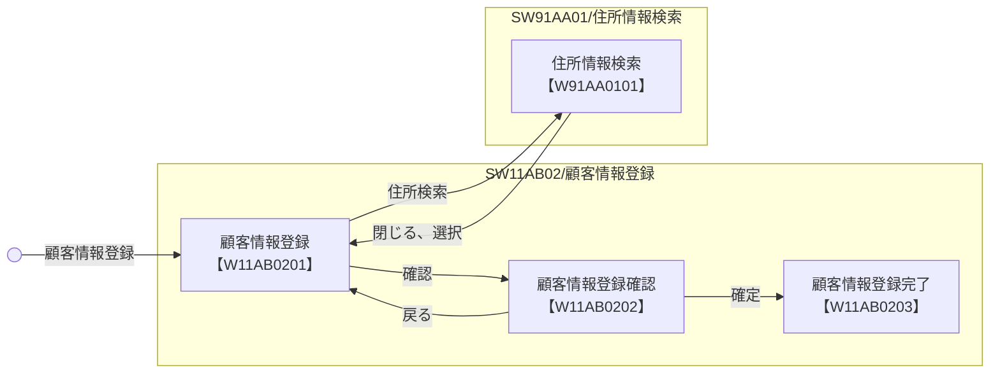

# ipa-ai-driven

Word / Excel の設計書を、GitHub Copilot が読める Markdown に変換するツールです。

> **開発中です。** サンプルの設計書で動作を確認している段階で、まだ業務では使えません。

## 背景

設計書の多くは Word や Excel で書かれており、AI はそのままではうまく読めません。既存の変換ツールでは、図形で描いた図が消えてしまいます。

このツールは、文章と表を取り出し、図を Mermaid（テキストで図を書く記法）に書き起こして、1つの Markdown にまとめます。

## 変換の例

変換前（Excel の図）


変換後（Mermaid）



変換後の文書の全体は [migrated/screen-transition/document.md](migrated/screen-transition/document.md) にあります。開発中の試行結果で、人による確認はまだです。

## 仕組み

1. プログラムが、文章と表を取り出す
2. GitHub Copilot が、図を Mermaid に書き起こす
3. プログラムが、原本の文字が抜けていないかを照合する
4. GitHub Copilot が、原本の図と見比べて確認する
5. 人が確認して、承認する

## 現在の状況

| 機能 | 状況 |
|---|---|
| Excel の文章と表の取り出し、原本との照合 | 動作する |
| GitHub Copilot による図の書き起こしと確認 | 試行中。精度に課題がある |
| Word の文書、貼り付けられた画像 | 未対応 |

詳細は [docs/handoff.md](docs/handoff.md) を参照してください。

## 使い方

Python 3.10 以上と、LibreOffice または Excel が必要です。

```
pip install -e ".[excel,dev]"

# 下書きと図の画像を作る
python -m docmig migrate "samples/nablarch/画面遷移図_サンプル.xlsx" --out migrated/trial-01

# 原本と照合する
python -m docmig verify migrated/trial-01
```

図の書き起こしから承認までの手順は [docs/runbook.md](docs/runbook.md) にあります。

## ドキュメント

| 文書 | 内容 |
|---|---|
| [docs/runbook.md](docs/runbook.md) | 変換の手順 |
| [docs/handoff.md](docs/handoff.md) | 現在の状況と、次の作業 |
| [docs/process.md](docs/process.md) | 開発の進め方（IPA「AI時代の要求管理ハンドブック」に沿う） |
| [AGENTS.md](AGENTS.md) | 作業する AI への指示 |

## ライセンス

[Unlicense](LICENSE)（自由に利用できます）。`samples/` の設計書は Nablarch 開発標準のサンプルで、[別のライセンス](samples/nablarch/README.md)です。

質問や不具合は [Issues](https://github.com/xclang-brain/ipa-ai-driven/issues) へお願いします。
