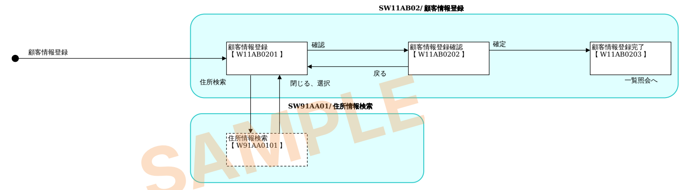

# ipa-ai-driven

Word や Excel で書かれた設計書を、AI が読める文書に作り直すための道具です。作り直した文書は、開発を手伝う AI「GitHub Copilot」に読ませて使います。

**開発の途中です。まだ業務には使えません。** 公開されているサンプルの設計書で、動作を確かめている段階です。

このページの読み方:

- どんな道具かを知りたい人は、[今の状態](#今の状態) まで読めば足ります。
- 自分で動かしたい開発者は、[動かしてみる](#動かしてみる開発者向け) を読んでください。
- この道具の開発に加わる人は、[開発に加わる人へ](#開発に加わる人へ) を読んでください。

## 何のためのものか

この道具は、ある会社のファームウェア開発部門（機器に組み込むソフトウェアを作る部門）の依頼で作っています。この部門には、Word と Excel で書かれた設計書がたくさんあります。開発を AI に手伝わせるために、設計書を AI に読ませたいのですが、次の問題があります。

- AI は、Word や Excel のファイルをそのままではうまく読めない。
- 既存の変換ツールを使うと、四角や矢印で描いた図が消えてしまう。

この道具は、設計書を、文字だけでできたファイルに作り直します。図は、文字で書いた図に置き換えて残します。

使う人として想定しているのは、設計書を作り直す作業の担当者です。作り直した文書を AI 経由で使うのは、部門の開発者です。誰が担当するかは、まだ決まっていません。

## 何をするのか（例）

サンプルの設計書の1ページで、作り直す前と後を示します。

**作り直す前。** Excel に、四角と矢印で描かれた図です。画面がどの順に切り替わるかを表しています。薄い「SAMPLE」の文字は、もとの設計書に入っているものです。



**作り直した後。** 同じ図を、文字で書いたものです。

```
flowchart LR
    s26761((" "))
    subgraph s26744["SW11AB02/顧客情報登録"]
        s26684["顧客情報登録<br>【W11AB0201】"]
        s26690["顧客情報登録確認<br>【W11AB0202】"]
        s26693["顧客情報登録完了<br>【W11AB0203】"]
    end
    subgraph s26743["SW91AA01/住所情報検索"]
        s26715["住所情報検索<br>【W91AA0101】"]
    end
    s26761 -->|"顧客情報登録"| s26684
    s26684 -->|"確認"| s26690
    s26690 -->|"戻る"| s26684
    s26690 -->|"確定"| s26693
    s26684 -->|"住所検索"| s26715
    s26715 -->|"閉じる、選択"| s26684
```

読み方は次のとおりです。

- `s26684` のような「s と数字」は、もとの図の四角1つずつに付いている番号です。
- `s26684["顧客情報登録…"]` の行は、四角とその中の文字を表します。`<br>` は改行です。
- `s26684 -->|"確認"| s26690` の行は、矢印を表します。「顧客情報登録の画面から、『確認』で、顧客情報登録確認の画面へ移る」という意味です。

この書き方は Mermaid（マーメイド）と呼ばれるものです。GitHub の画面で開くと、文字が図として表示されます。

この例について、知っておいてほしいこと:

- この例は、開発中の確認のために、GitHub Copilot とは別の AI に書かせたものです。GitHub Copilot に書かせた1回の試行では、もとの図にない矢印が2本書かれました。同じ結果は、まだ得られていません。
- 作り直した文書を AI が正しく読めるかは、これから確かめます。
- 文書の全体は [migrated/screen-transition/document.md](migrated/screen-transition/document.md) にあります。人の確認はまだで、読み取れなかった箇所が3件残っています。

## 今の状態

| 項目 | 状態 |
|---|---|
| Excel の設計書から、文章と表を取り出す | できる |
| 図を画像として保存する | LibreOffice（無料の表計算ソフト）ではできる。矢印1本が、もとの図と違う向きに描かれた。Excel では、まだ試していない |
| 作り直した文書に抜けがないかを、もとの設計書と比べて調べる | できる。1〜2文字の短い言葉の抜けは、見つけられないことがある |
| 図を GitHub Copilot に文字で書き直させる | 1回試して、誤りが出た。まだ使えない |
| Word の設計書を作り直す | まだできない |
| 貼り付けた画像の中の文字を読む | まだできない |
| 実際の業務の設計書で使う | まだ試していない |

詳しい状態と、次に行うことは [docs/handoff.md](docs/handoff.md) にあります。

## 作り直す流れ

プログラム、AI、人が分担します。AI は書き間違えることがあるため、AI に書かせるのは図だけにして、結果をプログラムと人が確かめます。

1. **プログラム**が、設計書から文章と表を取り出し、下書きを作る。図は画像として保存する。
2. **GitHub Copilot** が、図の画像を見て、文字で書いた図に書き直す。
3. **プログラム**が、もとの設計書の文字が、作り直した文書にすべて残っているかを調べる。
4. **GitHub Copilot** を、書き直しとは別の指示でもう一度動かし、もとの図と見比べさせる。
5. **人**が最後に確かめて、承認する。

## 動かしてみる（開発者向け）

ここから先は、コマンドを使える開発者向けです。上の流れの 1 と 3 を、サンプルの設計書で試せます。

必要なもの:

- Git と、Python 3.10 以上
- Excel（Windows）か LibreOffice のどちらか。図を画像として保存するために使います

```
git clone https://github.com/xclang-brain/ipa-ai-driven.git
cd ipa-ai-driven
pip install -e ".[excel,dev]"
python -m docmig migrate "samples/nablarch/画面遷移図_サンプル.xlsx" --out migrated/trial-01
```

`docmig` は、この道具のプログラムの名前です。最後の行が、流れの 1 です。成功すると次のように表示され、`migrated/trial-01/` に下書き（`document.md`）と図の画像ができます。1行目は、図の保存に使ったソフトの名前です。

```
描画: libreoffice
下書きを作成: migrated/trial-01/document.md（シート 5、図 5）
```

続けて、流れの 3 を実行します。

```
python -m docmig verify migrated/trial-01
```

次のように「不合格」と表示され、そのあとに「文字の欠落」の行がたくさん続きます。図をまだ書き直していないためで、正しい動きです。図の中の文字は、図を書き直すまで「欠落」と数えられます。

```
判定: 不合格
確認の状態: 未確認
原本の文字列: 111 件中、欠落 77 件
図: 5 件中、未記入 5 件
要確認の印: 0 件
```

試し終わったら、`migrated/trial-01` のフォルダを消してください。残っていると、次に同じコマンドを実行したときに「既にある」と表示されて止まります。

流れの 2、4、5 の手順は、[docs/runbook.md](docs/runbook.md) の「3. 図を書き起こす」から先にあります。GitHub Copilot の契約と、Copilot CLI（コマンドで GitHub Copilot を使う道具）が必要です。

## フォルダの中身

| 場所 | 中身 |
|---|---|
| `samples/` | 試すための設計書（Excel）。出どころとライセンスは [samples/nablarch/README.md](samples/nablarch/README.md) にある |
| `migrated/` | 作り直した文書。今あるものは、どれも試した結果で、人の確認は済んでいない |
| `src/docmig/`、`tests/` | プログラムと、そのテスト |
| `.github/agents/` | 図の書き直しと見比べを GitHub Copilot に任せるための指示書 |
| `docs/` | 手順書、開発の進め方、開発の記録 |
| `requirements/`、`tools/` | この道具に求めることの一覧と、それを表にするプログラム |
| `AGENTS.md` | このリポジトリで作業する AI に読ませる決まり |

## 開発に加わる人へ

この道具は、IPA（情報処理推進機構）の「[AI時代の要求管理ハンドブック](https://www.ipa.go.jp/digital/kaihatsu/rqr7mi000000f5up-att/req-mgmt-hb.pdf)」に沿って開発しています。頼まれたことをすぐに作らず、目的と、求めることを先に書き出してから作る進め方です。

作業の前に、次の順で読んでください。

1. [docs/process.md](docs/process.md)　開発の進め方と決まり。テストの実行方法もここにある
2. [docs/handoff.md](docs/handoff.md)　今の状態、工程ごとの進み具合、次に行うこと
3. [AGENTS.md](AGENTS.md)　AI 向けの決まり。人も、AI に何を守らせているかを知るために読む

## 問い合わせ

質問や不具合の報告は、このリポジトリの [Issues](https://github.com/xclang-brain/ipa-ai-driven/issues)（GitHub の、質問や報告を書き込む場所）に書いてください。
