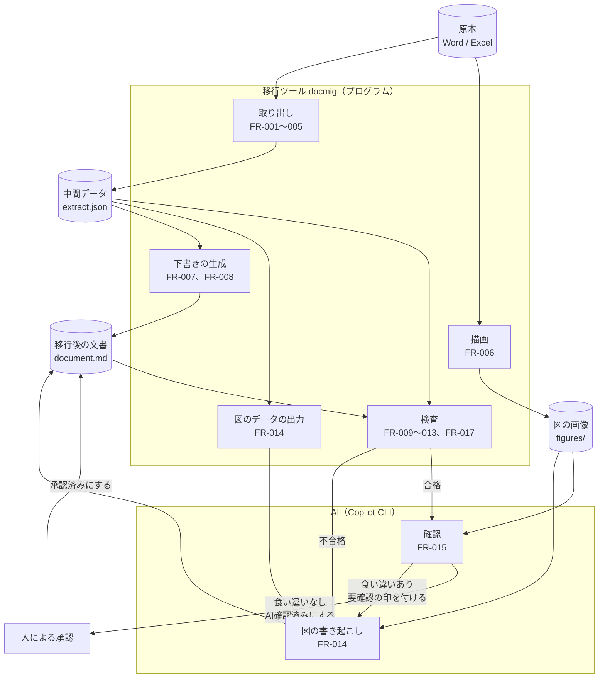
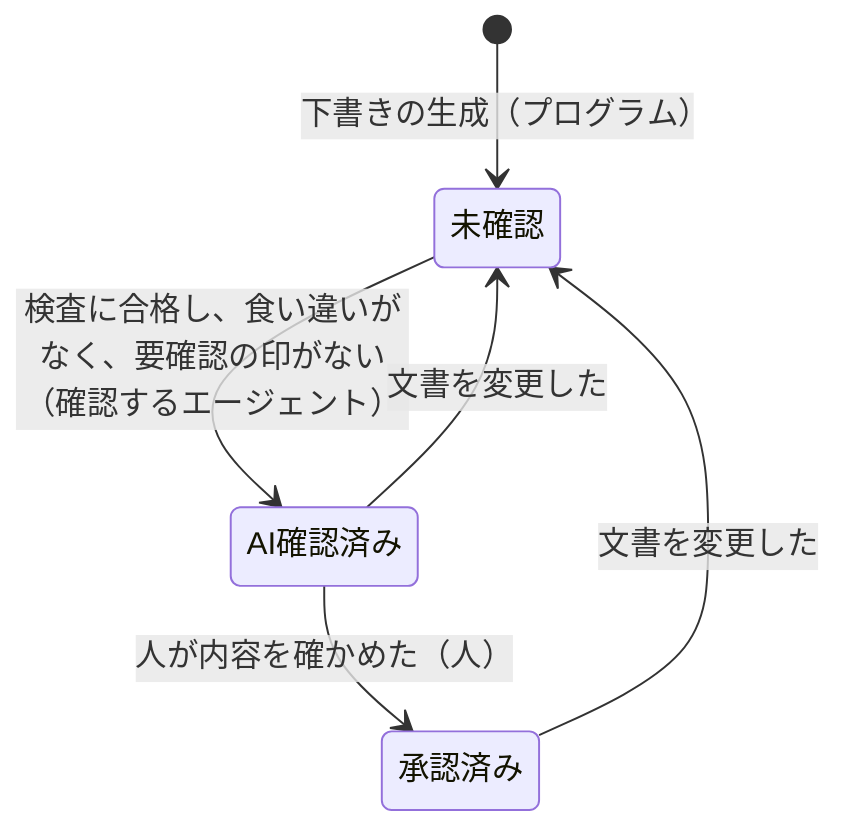
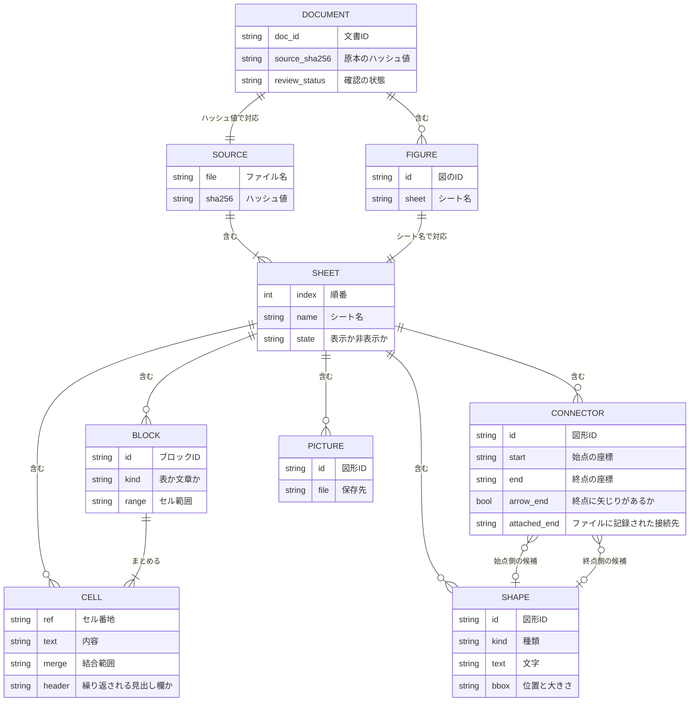

# モデル

| 項目 | 内容 |
|---|---|
| 文書ID | DOC-06 |
| 工程 | 6. モデリング |
| 版 | 1.0 |
| 作成日 | 2026-11-22 |

ハンドブック 7.2.6 節に従い、業務の流れ、データ、AI の利用箇所、確認の状態を図にした。図の中の FR は [要件台帳](../requirements/system-requirements.yaml) の要件ID である。

## 1. 移行の流れ

誰が何を行い、何が次の段階に渡るかを示す。

## 2. AI を使う箇所と、人に引き継ぐ条件

| 箇所 | AI が行うこと | AI に渡すもの | 人に引き継ぐ条件 |
|---|---|---|---|
| 図の書き起こし | 図のつながりを読み取り、Mermaid で書く | 図の画像、図形と矢印の一覧 | 読み取れない箇所がある（要確認の印）。検査の欠落を3回直しても解消できない。画像を見られない |
| 確認 | 画像と書き起こしを見比べ、食い違いを報告する | 図の画像、図形と矢印の一覧、移行後の文書 | 食い違いがある（要確認の印）。検査に不合格 |
| 移行後の利用 | 文書を根拠に、質問に答え、実装する | 移行後の文書 | 要確認の印がある箇所に依存する。文書に書かれていない |

文字の取り出しと照合には AI を使わない。同じ入力から常に同じ結果が得られ、規則で書けるためである（[要求分析](04-analysis.md) 5章）。

## 3. 確認の状態

`review_status` の値と、変えられる担い手を示す（FR-009、FR-013、FR-015）。

- `承認済み` に変えられるのは人だけである。
- 検査は、状態と内容の矛盾（不合格なのに `AI確認済み`、要確認の印が残っているのに `承認済み`）を誤りとして報告する。
- 文書を変更したときに状態を `未確認` に戻すことは、初回は運用の決まりとする。道具による強制は行っていない。

## 4. データ

中間データ（extract.json）と、移行後の文書との関係を示す。

