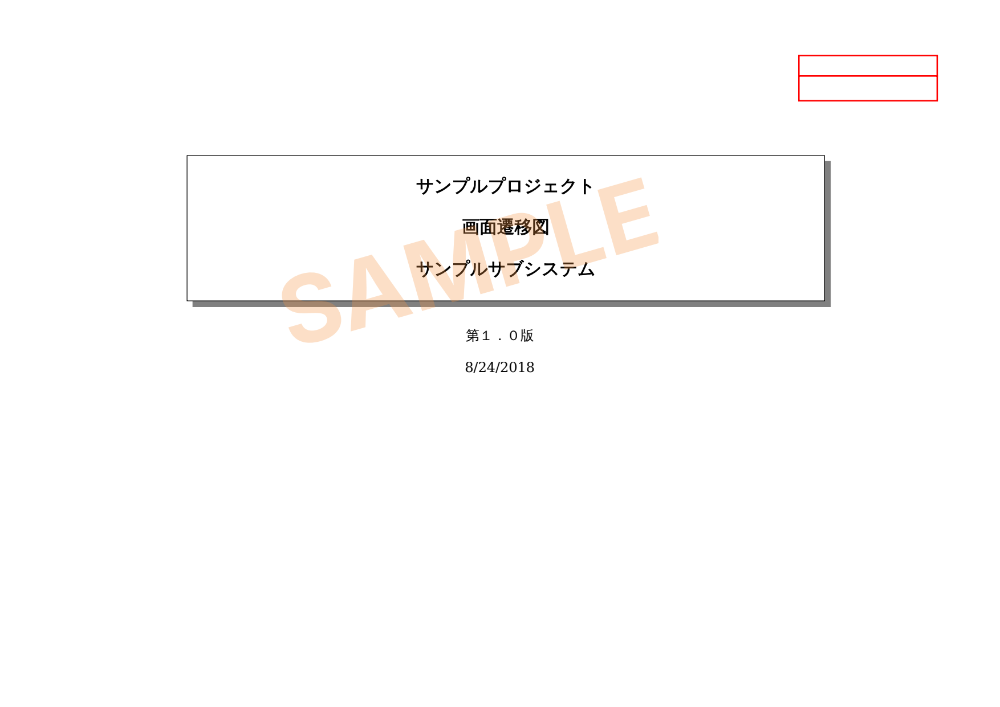
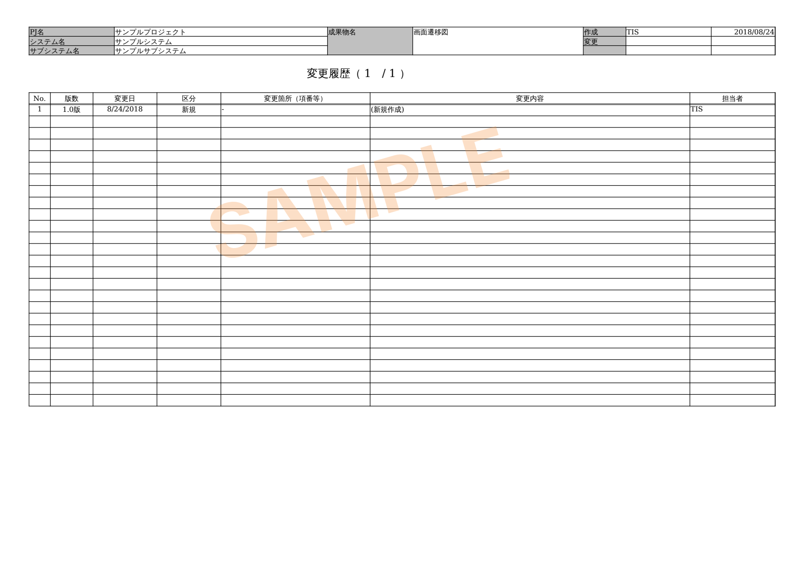
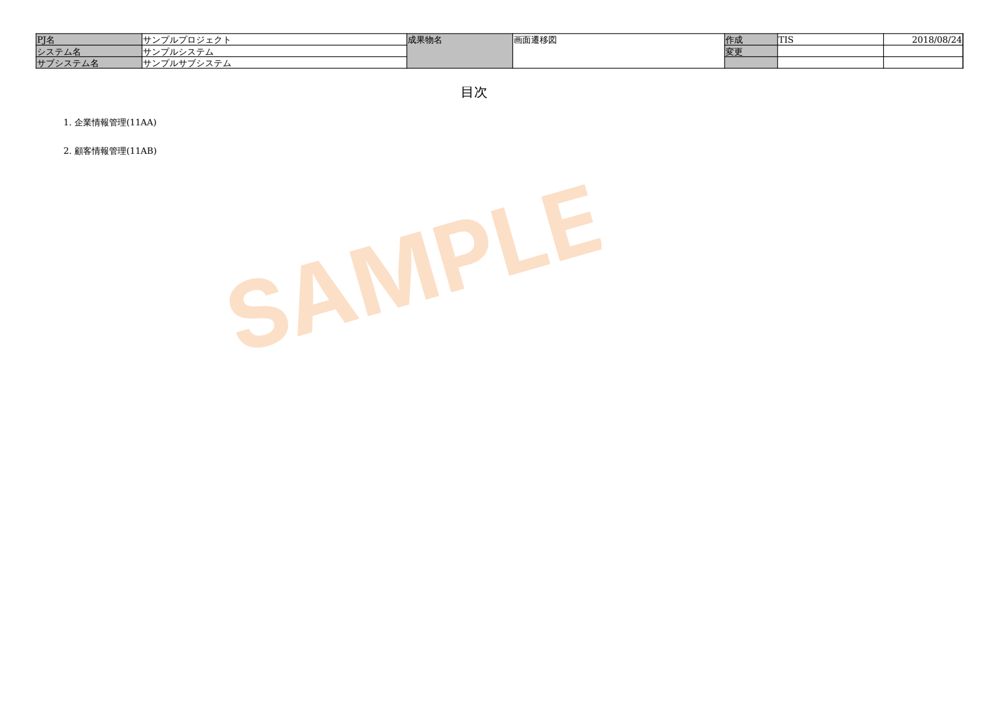
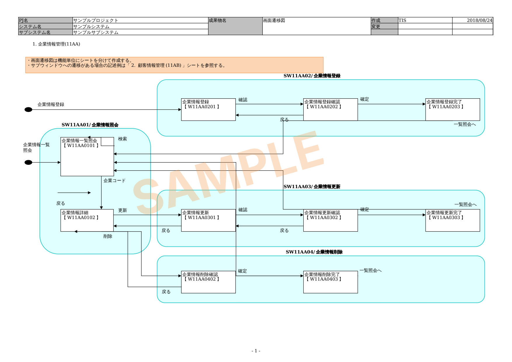
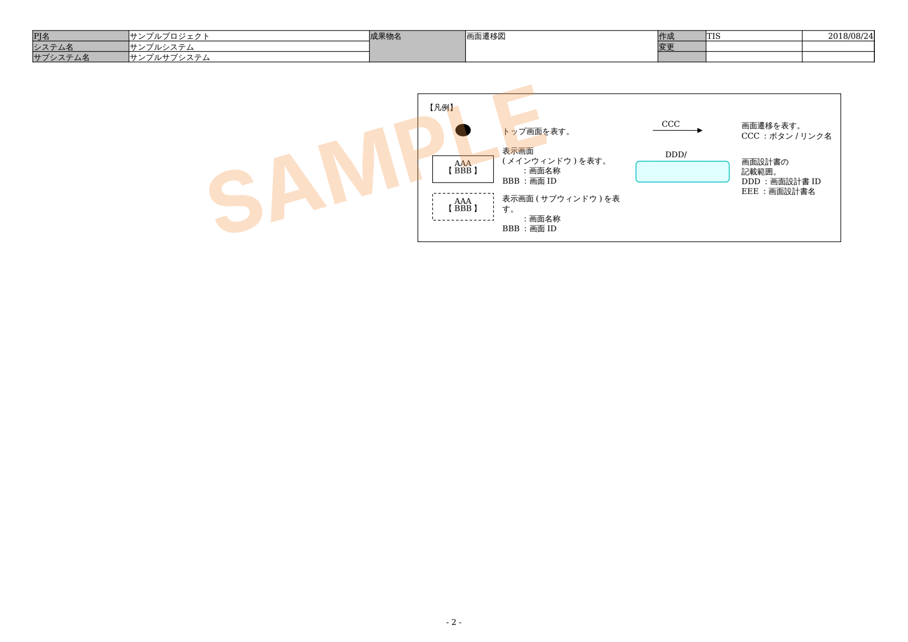
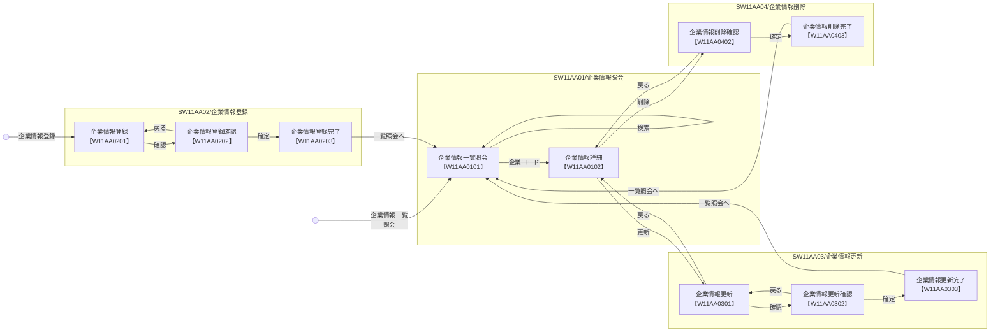
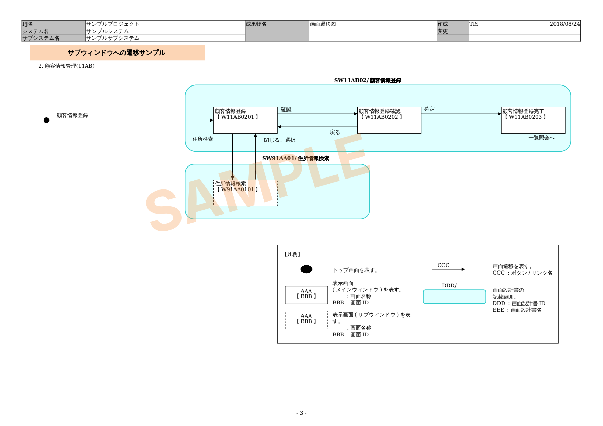
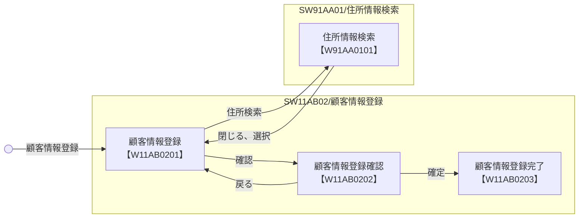

# 画面遷移図_サンプル

## 文書の属性

<!-- src: sheet="変更履歴、目次、1. 企業情報管理(11AA)、2. 顧客情報管理(11AB)" range="A1:AI3" -->
|  |  |  |  |  |  |  |
| --- | --- | --- | --- | --- | --- | --- |
| PJ名 | サンプルプロジェクト | 成果物名 | 画面遷移図 | 作成 | TIS | 2018-08-24 |
| システム名 | サンプルシステム |  |  | 変更 |  |  |
| サブシステム名 | サンプルサブシステム |  |  |  |  |  |

## 表紙

<!-- src: sheet="表紙" range="J23:J23" -->
第１．０版

<!-- src: sheet="表紙" range="I25:K25" -->
2018-08-24

<!-- figure:begin id="fig-s1" sheet="表紙" -->

つながりを表す図形はない。

- 表紙の題名の枠（s5）: サンプルプロジェクト  画面遷移図  サンプルサブシステム
- 表紙の右上の赤い枠の注記（s3）: 関係者外秘
- 表紙の右上の赤い枠の注記（s4）: PJ関係者限り
- 透かし（s7）: SAMPLE

【要確認: s3 と s4 の文字は一覧にあるが、画像では赤い枠の中に文字が見えない】
<!-- figure:end -->

## 変更履歴

<!-- src: sheet="変更履歴" range="N5:N5" -->
変更履歴（ 1　/ 1 ）

<!-- src: sheet="変更履歴" range="A7:AI8" -->
|  |  |  |  |  |  |  |
| --- | --- | --- | --- | --- | --- | --- |
| No. | 版数 | 変更日 | 区分 | 変更箇所（項番等） | 変更内容 | 担当者 |
| 1 | 1.0版 | 2018-08-24 | 新規 | - | (新規作成) | TIS |

<!-- figure:begin id="fig-s2" sheet="変更履歴" -->

つながりを表す図形はない。

- 透かし（s3）: SAMPLE
<!-- figure:end -->

## 目次

<!-- src: sheet="目次" range="Q5:Q5" -->
目次

<!-- src: sheet="目次" range="B7:B7" -->
1. 企業情報管理(11AA)

<!-- src: sheet="目次" range="B9:B9" -->
2. 顧客情報管理(11AB)

<!-- figure:begin id="fig-s3" sheet="目次" -->

つながりを表す図形はない。

- 透かし（s3）: SAMPLE
<!-- figure:end -->

## 1. 企業情報管理(11AA)

<!-- src: sheet="1. 企業情報管理(11AA)" range="B5:B5" -->
1. 企業情報管理(11AA)

<!-- figure:begin id="fig-s4" sheet="1. 企業情報管理(11AA)" -->

- Mermaid に書いていない線（c23905）のラベル（s23579）: 戻る

【要確認: c23905 の始点と終点がどの画面か、画像から判断できない。画像では、s23558 と s23570 の間に、どの図形にも接していない右向きの矢印として描かれている。一覧の候補は、始点側が s23579（ラベルの文字枠）、終点側が s23558 で、画像と食い違う】

補足: subgraph の s23889、s23872、s23874、s23873 の見出しは、それぞれ s23712、s23823、s23714、s23759 の文字である。

つながりを表さない図形:

- 注記（s23871）: ・画面遷移図は機能単位にシートを分けて作成する。 ・サブウィンドウへの遷移がある場合の記述例は「2. 顧客情報管理(11AB)」シートを参照する。
- 文字のない文字枠（画像では見えない）: s23898、s23899
- 透かし（s81）: SAMPLE
- 透かし（s82）: SAMPLE
- 凡例（s129 の枠の中）
  - 凡例の見出し（s130）: 【凡例】
  - 凡例の記号（s134、黒丸）の説明（s135）: トップ画面を表す。
  - 凡例の記号（s128、実線の四角）の文字: AAA 【BBB】
  - s128 の説明（s132）: 表示画面 (メインウィンドウ)を表す。 AAA：画面名称 BBB：画面ID
  - 凡例の記号（s139、破線の四角）の文字: AAA 【BBB】
  - s139 の説明（s140）: 表示画面(サブウィンドウ)を表す。 AAA：画面名称 BBB：画面ID
  - 凡例の記号（c141、矢印）のラベル（s142）: CCC
  - c141 の説明（s133）: 画面遷移を表す。 CCC：ボタン/リンク名
  - 凡例の記号（s136、角の丸い枠）の見出し（s137）: DDD/EEE
  - s136 の説明（s138）: 画面設計書の 記載範囲。 DDD：画面設計書ID EEE：画面設計書名
<!-- figure:end -->

## 2. 顧客情報管理(11AB)

<!-- src: sheet="2. 顧客情報管理(11AB)" range="B7:B7" -->
2. 顧客情報管理(11AB)

<!-- figure:begin id="fig-s5" sheet="2. 顧客情報管理(11AB)" -->

- 線のないラベル（s26694）: 一覧照会へ

【要確認: s26694 は s26693 の右下に置かれたラベルだが、対応する線が一覧にも画像にもなく、遷移先を判断できない】

補足: s26715 は画像では破線の枠で描かれ、subgraph の s26744、s26743 の見出しは、それぞれ s26681、s26719 の文字である。

つながりを表さない図形:

- 注記（s43）: サブウィンドウへの遷移サンプル
- 透かし（s41）: SAMPLE
- 凡例（s136 の枠の中）
  - 凡例の見出し（s137）: 【凡例】
  - 凡例の記号（s143、黒丸）の説明（s144）: トップ画面を表す。
  - 凡例の記号（s135、実線の四角）の文字: AAA 【BBB】
  - s135 の説明（s141）: 表示画面 (メインウィンドウ)を表す。 AAA：画面名称 BBB：画面ID
  - 凡例の記号（s148、破線の四角）の文字: AAA 【BBB】
  - s148 の説明（s149）: 表示画面(サブウィンドウ)を表す。 AAA：画面名称 BBB：画面ID
  - 凡例の記号（c139、矢印）のラベル（s140）: CCC
  - c139 の説明（s142）: 画面遷移を表す。 CCC：ボタン/リンク名
  - 凡例の記号（s145、角の丸い枠）の見出し（s146）: DDD/EEE
  - s145 の説明（s147）: 画面設計書の 記載範囲。 DDD：画面設計書ID EEE：画面設計書名
<!-- figure:end -->
