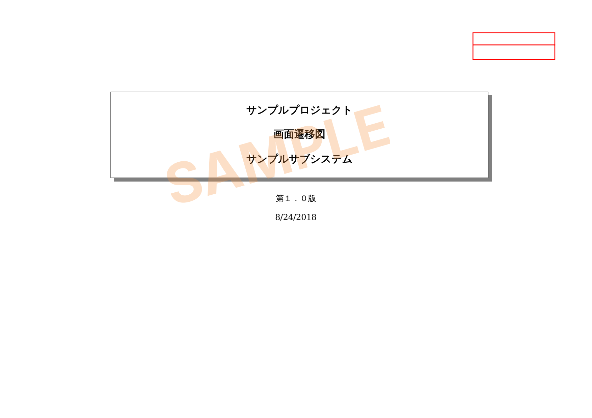
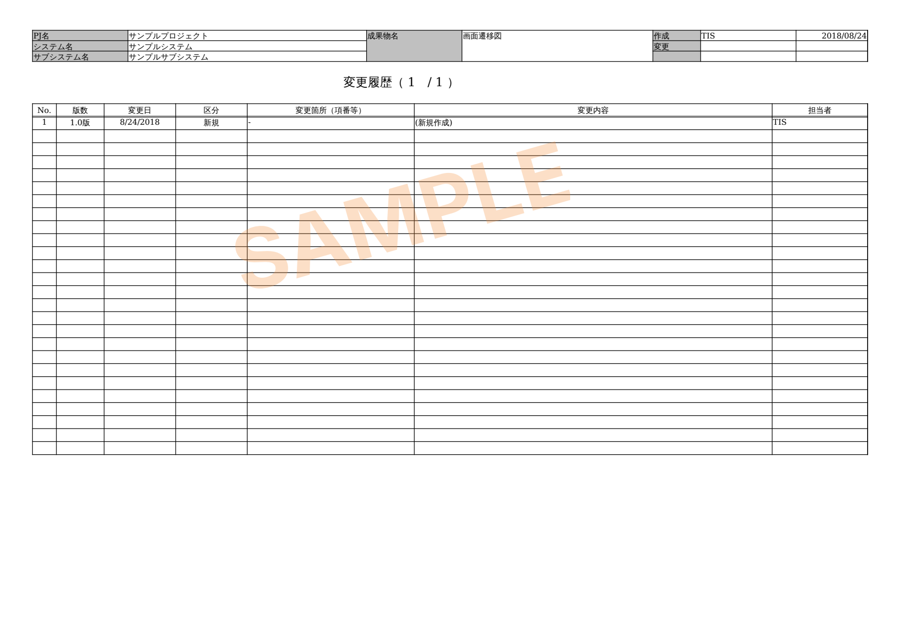
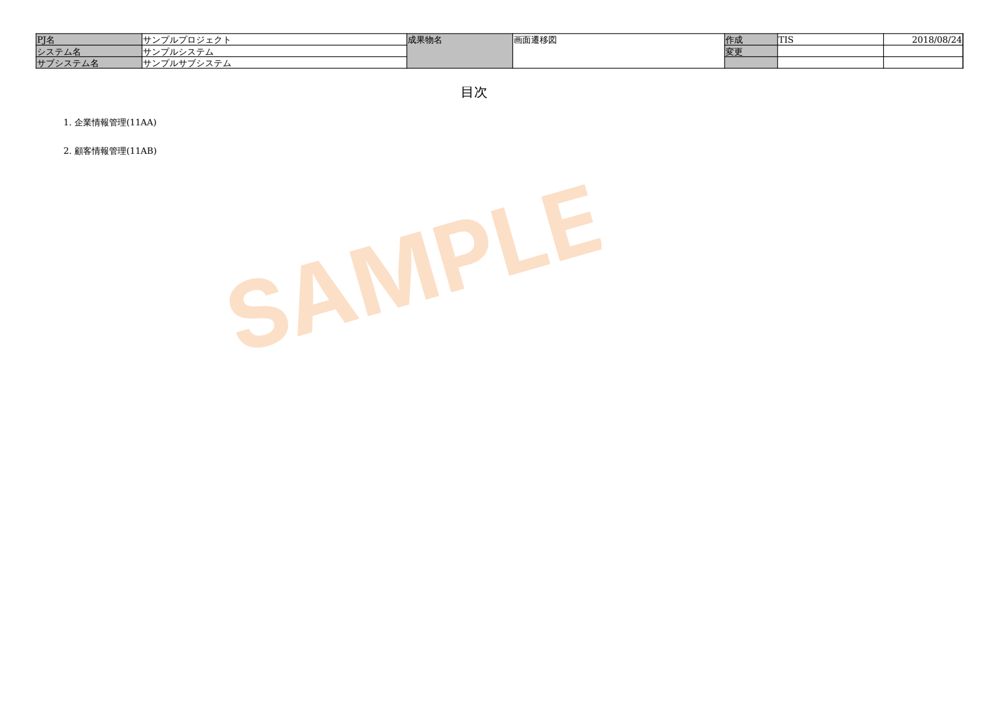
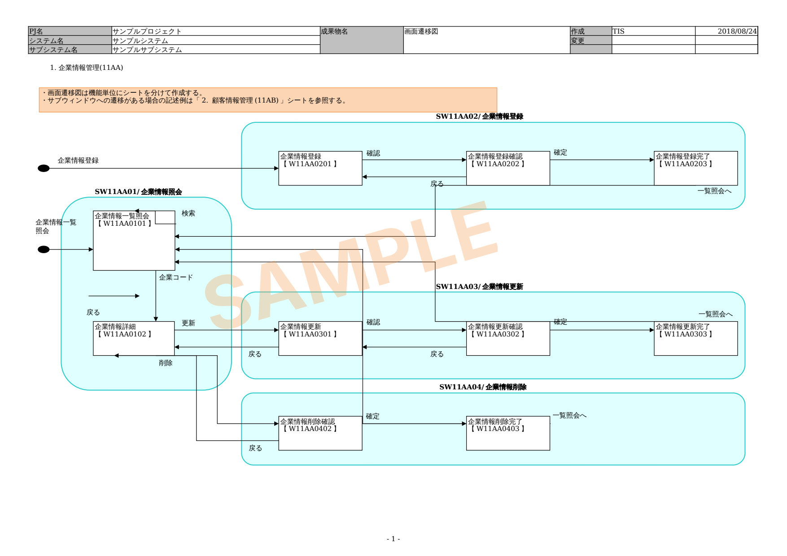
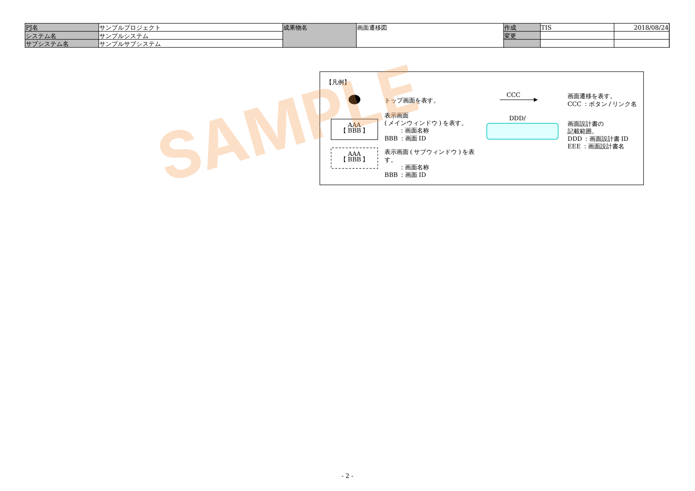
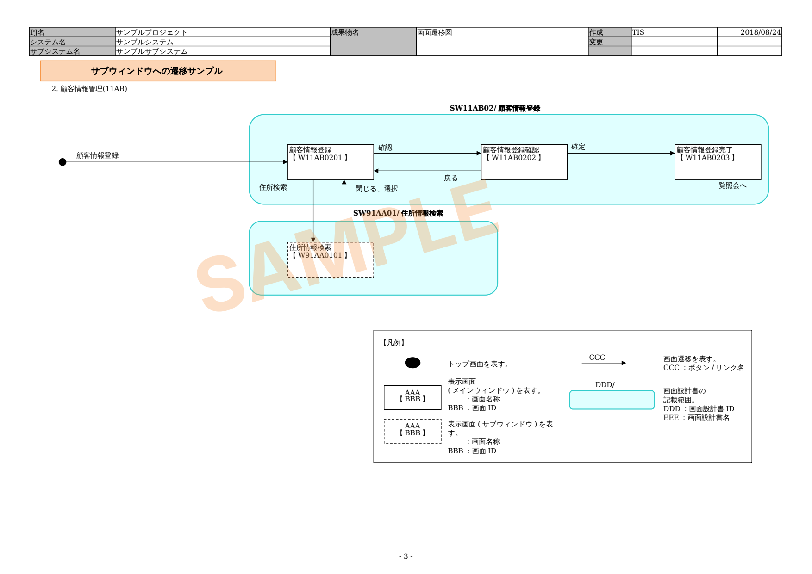

# 画面遷移図_サンプル

## 文書の属性

<!-- src: sheet="変更履歴、目次、1. 企業情報管理(11AA)、2. 顧客情報管理(11AB)" range="A1:AI3" -->
|  |  |  |  |  |  |  |
| --- | --- | --- | --- | --- | --- | --- |
| PJ名 | サンプルプロジェクト | 成果物名 | 画面遷移図 | 作成 | TIS | 2018-08-24 |
| システム名 | サンプルシステム |  |  | 変更 |  |  |
| サブシステム名 | サンプルサブシステム |  |  |  |  |  |

## 表紙

<!-- src: sheet="表紙" range="J23:J23" -->
第１．０版

<!-- src: sheet="表紙" range="I25:K25" -->
2018-08-24

<!-- figure:begin id="fig-s1" sheet="表紙" -->


<!-- transcription:todo -->
<!-- figure:end -->

## 変更履歴

<!-- src: sheet="変更履歴" range="N5:N5" -->
変更履歴（ 1　/ 1 ）

<!-- src: sheet="変更履歴" range="A7:AI8" -->
|  |  |  |  |  |  |  |
| --- | --- | --- | --- | --- | --- | --- |
| No. | 版数 | 変更日 | 区分 | 変更箇所（項番等） | 変更内容 | 担当者 |
| 1 | 1.0版 | 2018-08-24 | 新規 | - | (新規作成) | TIS |

<!-- figure:begin id="fig-s2" sheet="変更履歴" -->


<!-- transcription:todo -->
<!-- figure:end -->

## 目次

<!-- src: sheet="目次" range="Q5:Q5" -->
目次

<!-- src: sheet="目次" range="B7:B7" -->
1. 企業情報管理(11AA)

<!-- src: sheet="目次" range="B9:B9" -->
2. 顧客情報管理(11AB)

<!-- figure:begin id="fig-s3" sheet="目次" -->


<!-- transcription:todo -->
<!-- figure:end -->

## 1. 企業情報管理(11AA)

<!-- src: sheet="1. 企業情報管理(11AA)" range="B5:B5" -->
1. 企業情報管理(11AA)

<!-- figure:begin id="fig-s4" sheet="1. 企業情報管理(11AA)" -->



<!-- transcription:todo -->
<!-- figure:end -->

## 2. 顧客情報管理(11AB)

<!-- src: sheet="2. 顧客情報管理(11AB)" range="B7:B7" -->
2. 顧客情報管理(11AB)

<!-- figure:begin id="fig-s5" sheet="2. 顧客情報管理(11AB)" -->


```mermaid
flowchart LR
    %% メインウィンドウの枠
    subgraph s26744[" "]
        direction LR
        s26684["顧客情報登録<br>【W11AB0201】"]
        s26690["顧客情報登録確認<br>【W11AB0202】"]
        s26693["顧客情報登録完了<br>【W11AB0203】"]
        s26681["SW11AB02/顧客情報登録"]
        s26684 -- "確認" --> s26690
        s26690 -- "確定" --> s26693
        s26690 -- "戻る" --> s26684
        s26684 -- "住所検索" --> s26715
        s26715["住所情報検索<br>【W91AA0101】"]
        s26719["SW91AA01/住所情報検索"]
        s26715 -- "閉じる、選択" --> s26684
        s26693 -- "一覧照会へ" --> s26694["一覧照会へ"]
    end
    %% サブウィンドウの枠
    subgraph s26743[" "]
        s26715
    end
    s26761((" "))
    s26761 -- "顧客情報登録" --> s26684
    s26698["顧客情報登録"]
    s26698 -- "" --> s26761
    %% タイトル
    s43["サブウィンドウへの遷移サンプル"]
```
- s41（透かし）: SAMPLE
- s26682（ラベル。対応する線なし）: 確認
- s26683（ラベル。対応する線なし）: 戻る
- s26688（ラベル。対応する線なし）: 確定
- s26720（ラベル。対応する線なし）: 住所検索
- s26721（ラベル。対応する線なし）: 閉じる、選択
- s137（凡例 見出し）: 【凡例】
- s140（凡例）: CCC
- s141（凡例）: 表示画面<br>(メインウィンドウ)を表す。<br>AAA：画面名称<br>BBB：画面ID
- s142（凡例）: 画面遷移を表す。<br>CCC：ボタン/リンク名
- s143（凡例）: （黒丸）
- s144（凡例）: トップ画面を表す。
- s146（凡例）: DDD/EEE
- s147（凡例）: 画面設計書の<br>記載範囲。<br>DDD：画面設計書ID<br>EEE：画面設計書名
- s148（凡例）: AAA<br>【BBB】（破線の枠）
- s149（凡例）: 表示画面(サブウィンドウ)を表す。<br>AAA：画面名称<br>BBB：画面ID

<!-- figure:end -->
